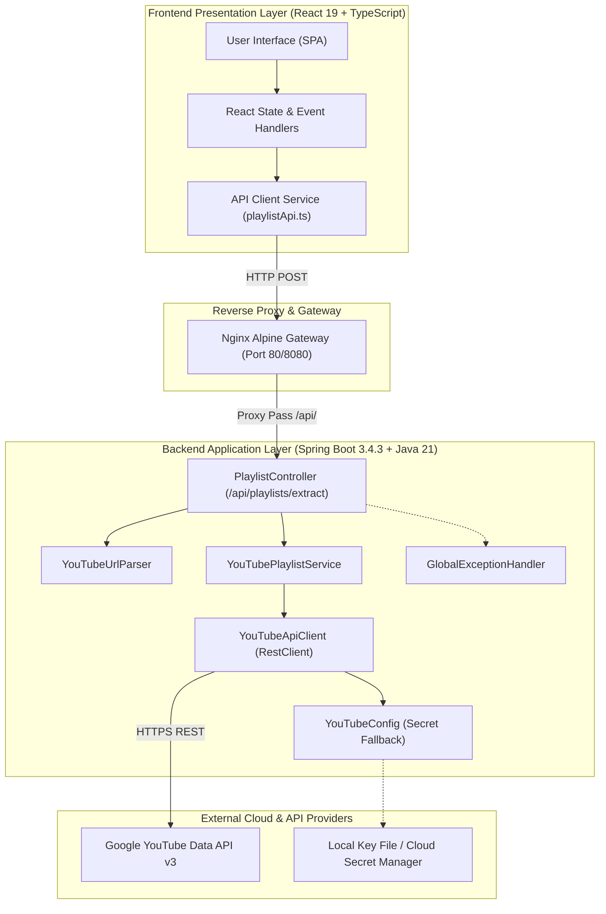
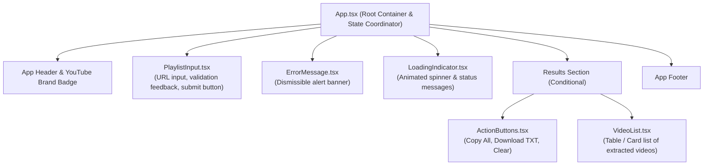
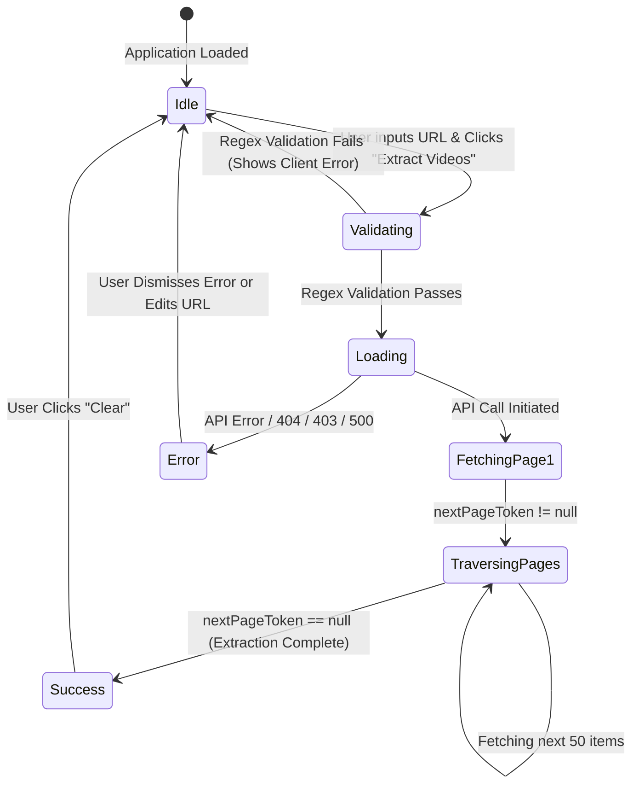

# System Design Document: YouTube Playlist Video Extractor

## 1. Executive Summary
The **YouTube Playlist Video Extractor** is a production-ready, full-stack web application designed to parse YouTube playlist URLs, systematically traverse paginated YouTube Data API v3 endpoints, and return a clean, consolidated list of video URLs, titles, and positions. It offers an intuitive, high-performance UI allowing users to view, copy, and export extracted links.

---

## 2. High-Level Architecture Overview

The system follows a modern decoupled client-server architecture:

---

## 3. Component Design & Decomposition

### 3.1 Frontend Component Hierarchy
The UI is decomposed into atomic, focused React components adhering to single-responsibility design:

### 3.2 Backend Component Design
The backend follows Spring Boot’s layered architecture:
1. **Presentation Layer (`PlaylistController`)**: Exposes REST endpoints, validates incoming JSON payloads using Jakarta Bean Validation (`@Valid`).
2. **Domain/Service Layer (`YouTubePlaylistService`)**: Handles the business orchestration of traversing all pages until `nextPageToken` is null.
3. **Integration Layer (`YouTubeApiClient`)**: Interacts with the external YouTube Data API v3 using Spring 6's modern synchronous `RestClient`.
4. **Configuration & Security Layer (`YouTubeConfig`)**: Resolves API keys from environment variables, system properties, or physical key files with dynamic fallback and sanitization.
5. **Cross-Cutting Concerns (`GlobalExceptionHandler`, `CorsConfig`)**: Centralized error mapping and CORS policy enforcement.

---

## 4. State Management & Data Flow

---

## 5. Security & Reliability Design

### 5.1 API Key Security
- **No Hardcoded Keys**: API keys are never embedded in frontend code or Git repositories.
- **Backend Key Shielding**: All YouTube Data API calls happen on the backend server; the client browser never sees the API key.
- **Fail-Safe Fallback**: If `YOUTUBE_API_KEY` is not present in container environment variables, `YouTubeConfig` safely attempts reading from the pre-configured local file `C:\dev\Youtube_API.txt`.

### 5.2 Input Sanitization & Validation
- **URL Syntax Filtering**: Client and server validate URLs against YouTube patterns (`youtube.com/playlist?list=...`, `youtu.be/...`).
- **Quota & Rate Limiting**: The backend requests `part=snippet` only (lowest quota consumption of 1 unit per 50 playlist items) instead of expensive content detail queries.

### 5.3 High Availability & Scalability
- **Stateless Backend**: The Spring Boot backend retains no user sessions or server state, making it horizontally scalable across multiple Cloud Run or Kubernetes instances.
- **Nginx Caching**: Static frontend assets (`.js`, `.css`, SVG) are served with `Cache-Control: public, immutable` and 1-year expiration headers.
