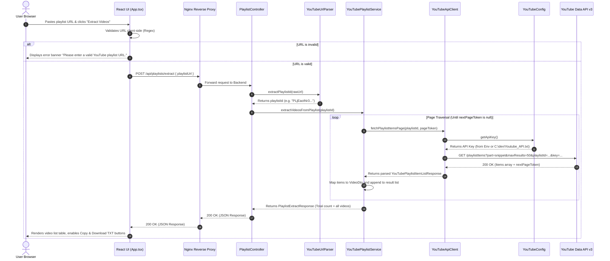
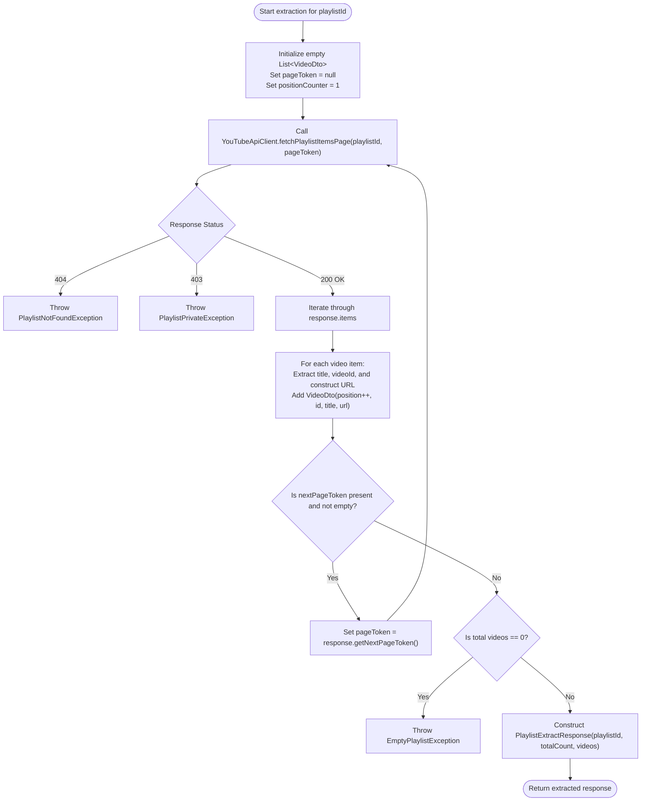
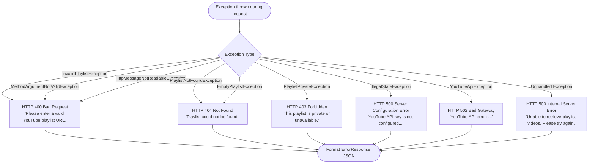
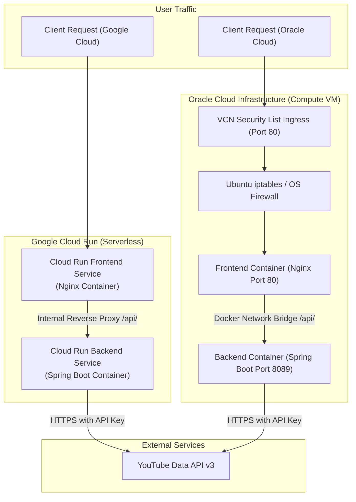

# System Flow Diagrams: YouTube Playlist Video Extractor

This document provides visual flowcharts, sequence diagrams, and decision trees illustrating how data moves through the application.

---

## 1. End-to-End Extraction Sequence Diagram

This sequence diagram depicts the exact interactions when a user submits a YouTube playlist URL:



---

## 2. YouTube URL Parsing & Validation Flow

This flowchart illustrates the logic inside `YouTubeUrlParser.java` when validating user input:

```mermaid
flowchart TD
    Start([Receive raw URL input]) --> CheckNull{Is string null or blank?}
    CheckNull -- Yes --> ThrowInvalid[Throw InvalidPlaylistException]
    CheckNull -- No --> ParseHost[Parse URI Host]

    ParseHost --> HasHost{Host present?}
    HasHost -- Yes --> ValidateHost{Is host youtube.com,<br/>youtu.be, or m.youtube.com?}
    ValidateHost -- No --> ThrowInvalid
    ValidateHost -- Yes --> RegexMatch[Run Regex: [?&]list=([a-zA-Z0-9_-]+)]

    HasHost -- No --> CheckPrefix{Does it start with<br/>playlist? or watch? or contain list=?}
    CheckPrefix -- No --> ThrowInvalid
    CheckPrefix -- Yes --> RegexMatch

    RegexMatch --> MatchFound{list= match found?}
    MatchFound -- Yes --> CheckIdFormat{Matches ID pattern<br/>[a-zA-Z0-9_-]{2,100}?}
    CheckIdFormat -- Yes --> ReturnId([Return extracted Playlist ID])
    CheckIdFormat -- No --> QueryFallback[Fallback to URI Query String Split]

    MatchFound -- No --> QueryFallback
    QueryFallback --> QueryParamLoop{Iterate key=value pairs:<br/>Is key 'list' and value valid?}
    QueryParamLoop -- Yes --> ReturnId
    QueryParamLoop -- No --> ThrowInvalid
```

---

## 3. Backend Pagination Traversal Flow

How `YouTubePlaylistService` gathers all videos from large playlists containing hundreds of entries:



---

## 4. Error Handling & Status Code Decision Tree

How exceptions are mapped to standard HTTP status codes in `GlobalExceptionHandler.java`:



---

## 5. Dual-Cloud Deployment & Routing Architecture

Comparison of how user traffic is routed in Google Cloud Run vs. Oracle Cloud Infrastructure:


