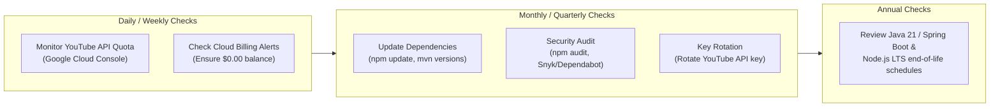

# Application Maintenance, Cost Analysis & Architecture Evaluation

This document outlines the **operational costs**, **maintenance procedures**, **periodic review checklist**, and the **advantages and disadvantages** of the **YouTube Playlist Video Extractor** application.

---

## 1. Cost Analysis & Breakdown

The application has been engineered to operate **virtually free of cost** across all tiers using modern serverless and cloud free-tier allocations.

### 1.1 Cloud Infrastructure Costs

| Service / Resource | Free Tier Allowance | Our Usage & Impact | Estimated Monthly Cost |
| :--- | :--- | :--- | :--- |
| **Google Cloud Run (Backend & Frontend)** | 2,000,000 requests/month 360,000 GiB-seconds RAM 180,000 vCPU-seconds | Scale-to-zero when idle. Containers only consume resources while actively extracting playlists. | **$0.00 / month** *(Within Free Tier)* |
| **Google Cloud Artifact Registry** | 500 MB storage free | Optimized Alpine & Slim container images (~165 MB total). | **$0.00 / month** |
| **Google Cloud Logging** | 50 GB log ingestion/month | Application logs consume &lt; 50 MB/month. | **$0.00 / month** |
| **Oracle Cloud (OCI Always Free)** *(Alternative)* | 4 OCPU, 24 GB RAM (Ampere A1) 10 TB outbound data transfer | Can host frontend + backend containers on a single Always Free VM indefinitely. | **$0.00 / month** *(100% Free Forever)* |

---

### 1.2 YouTube Data API v3 Costs & Quota

Google provides a generous **free daily quota** for the YouTube Data API v3:
- **Default Daily Quota**: **10,000 units per day** (resets every midnight Pacific Time).
- **Cost per Call**:
  - `playlistItems.list` with `part=snippet`: **1 quota unit** per 50 videos.
- **Capacity**:
  - One 50-video playlist = **1 unit**.
  - One 250-video playlist (5 pages) = **5 units**.
  - **Daily Limit**: You can extract up to **10,000 playlist pages** (up to **500,000 videos**) every single day for **$0.00**.
- **Additional Quota**: If higher volume is ever needed, additional quota can be requested from Google at no cost via the Google Cloud Console Quota Request form.

---

### 1.3 Total Estimated Monthly Cost Summary

| Traffic Scenario | Monthly Extractions | Infrastructure (GCP / OCI) | YouTube API | Total Cost |
| :--- | :--- | :--- | :--- | :--- |
| **Hobby / Personal** | 1,000 – 10,000 requests | $0.00 | $0.00 | **$0.00 / month** |
| **Small / Medium Web App** | 10,000 – 500,000 requests | $0.00 | $0.00 | **$0.00 / month** |
| **High Traffic Enterprise** | 2,000,000+ requests | ~$5.00 – $15.00 | $0.00 (requested quota) | **~$5 – $15 / month** |

---

## 2. Maintenance & Periodic Review Checklist

To keep the application running smoothly, perform the following periodic reviews:

### 2.1 What to Review From Time to Time

| Frequency | Item | What to Check & Action |
| :--- | :--- | :--- |
| **Weekly** | **YouTube Quota Consumption** | Visit [GCP API Quotas](https://console.cloud.google.com/apis/api/youtube.googleapis.com/quotas) to verify daily usage percentage. |
| **Monthly** | **Cloud Billing & Invoices** | Verify that Google Cloud or Oracle Cloud invoices remain at **$0.00**. Ensure billing budget threshold alerts ($1) are active. |
| **Monthly** | **Log Error Rates** | Check [Google Cloud Logs Explorer](https://console.cloud.google.com/logs/query?project=youtube-paylist-extractor) for repetitive client 400 or 500 exceptions. |
| **Quarterly** | **Security & Dependency Updates** | Run `npm audit` in `frontend/` and `mvn versions:display-dependency-updates` in `backend/` to apply security patches. |
| **Quarterly** | **API Key Rotation** | Rotate the YouTube API key in Google Cloud Console -> Credentials and update the backend environment variable. |
| **As Needed** | **Container Image Rebuild** | Rebuild container images (`gcloud run deploy` or `docker compose build`) to pick up the latest Alpine security patches. |

---

## 3. Advantages of the Application (Pros)

1. **Zero Server Idle Cost (Scale-to-Zero)**:
   - On Google Cloud Run, instances scale down to 0 when no users are on the site. You pay nothing when the application is idle.

2. **Security & Credential Shielding**:
   - The client browser never receives or stores the YouTube API key. All external API calls occur server-side through Spring Boot.

3. **Complete Pagination Support**:
   - Traverses playlists of arbitrary length (10, 100, 500+ videos) through automatic `nextPageToken` resolution.

4. **Stateless & Horizontally Scalable**:
   - The backend does not store session data or database state. It can scale instantly from 1 to 100 instances without session synchronization bottlenecks.

5. **Multi-Cloud Flexibility**:
   - Out of the box, the application supports **Google Cloud Run** (Serverless) and **Oracle Cloud Infrastructure** (Compute VM via `docker-compose.yml`), preventing vendor lock-in.

6. **High-Performance Production Containers**:
   - Multi-stage Docker builds produce lightweight images (Java JRE Alpine ~140 MB, Nginx Alpine ~25 MB), ensuring rapid deployment and low memory footprint.

7. **Rich Client Experience**:
   - Interactive UI with instant one-click clipboard copy, plain-text download (.txt), and direct video hyperlinks.

---

## 4. Disadvantages & Limitations (Cons)

1. **Dependent on YouTube API Quota Limits**:
   - The free quota is capped at 10,000 units per day. If a user or bot spams millions of queries, the API key quota can be exhausted until midnight Pacific Time.

2. **Restricted to Public / Unlisted Playlists**:
   - Due to YouTube Data API policies, **YouTube Mixes** (`list=RD...`), **Watch Later** (`list=WL`), and private playlists cannot be extracted without OAuth2 user login.

3. **Cloud Run Cold Starts**:
   - If no requests are received for ~15 minutes, Cloud Run scales down to zero instances. The next visitor may experience a 3–5 second cold start while the Spring Boot JVM initializes. *(Can be eliminated by setting `--min-instances 1` if desired).*

4. **No Historical Link Persistence**:
   - The app does not save previous playlist extractions in a database. If the user refreshes without copying or downloading links, they must re-run the extraction.

---

## 5. Recommended Future Enhancements

- **Redis / In-Memory Caching**: Cache extracted playlist results for 1–2 hours to avoid redundant YouTube API calls and preserve quota for frequently requested playlists.
- **Rate Limiting**: Implement a token-bucket rate limiter (e.g. Bucket4j) in the Spring Boot backend to prevent single IP quota exhaustion.
- **Export Formats**: Add support for CSV and JSON download in addition to plain text.
