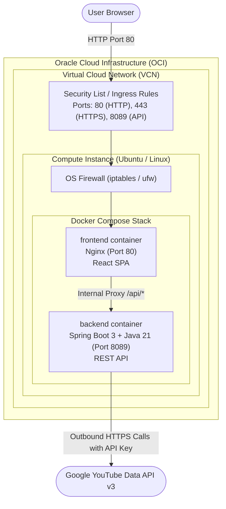

# Oracle Cloud Infrastructure (OCI) Deployment Guide

This guide provides end-to-end instructions for deploying the **YouTube Playlist Video Extractor** (Spring Boot 3 + React Vite) on an **Oracle Cloud Infrastructure (OCI) Compute Instance** (utilizing the OCI Always Free Tier).

---

## 1. Architecture & Deployment Flow Diagram



---

## 2. Application Access URLs

Once deployed on your Oracle Cloud VM:

| Service | Access URL | Description |
| :--- | :--- | :--- |
| **Frontend Web UI** | `http://<YOUR_OCI_PUBLIC_IP>` | Main user interface to extract playlists |
| **Backend REST API** | `http://<YOUR_OCI_PUBLIC_IP>:8089` | Spring Boot REST service |
| **Swagger / OpenAPI UI** | `http://<YOUR_OCI_PUBLIC_IP>:8089/swagger-ui.html` | Interactive API documentation |
| **OpenAPI Docs JSON** | `http://<YOUR_OCI_PUBLIC_IP>:8089/v3/api-docs` | Raw OpenAPI spec |

*(Optional: If you already configured a custom domain or DNS A-record pointing to your public IP, you can use `http://yourdomain.com`).*

---

## 3. Step-by-Step Deployment Instructions

### Step 1: Create an Always Free Compute Instance in OCI

1. Log in to the [Oracle Cloud Console](https://cloud.oracle.com/).
2. Open the navigation menu (**☰**) -> **Compute** -> **Instances**.
3. Click **Create instance**:
   - **Name**: `youtube-playlist-extractor`
   - **Compartment**: Select your compartment (e.g., `root`).
   - **Image**: Choose **Ubuntu 22.04 LTS** (or **Oracle Linux 8/9**).
   - **Shape**:
     - *Recommended Always Free Option*: **Ampere VM.Standard.A1.Flex** (4 OCPUs, 24 GB RAM) or **VM.Standard.E2.1.Micro** (AMD).
   - **Networking**: Select your default Virtual Cloud Network (VCN) and ensure **Assign a public IPv4 address** is checked.
   - **Add SSH keys**: Select **Generate a key pair for me** and click **Save private key** (saves a `.key` file on your computer).
4. Click **Create**. Wait until the instance state changes from *Provisioning* to **Running** (takes ~1–2 minutes).
5. Copy your **Public IP Address** from the instance overview page.

---

### Step 2: Open Ingress Firewall Rules in OCI Security List

By default, Oracle Cloud blocks incoming HTTP/custom traffic. You must explicitly open ports:

1. In the Instance details page, locate **Primary VNIC** and click on your **Subnet** link.
2. Under **Security Lists**, click on **Default Security List for your VCN**.
3. Click **Add Ingress Rules**:
   - **Source Type**: `CIDR`
   - **Source CIDR**: `0.0.0.0/0`
   - **IP Protocol**: `TCP`
   - **Destination Port Range**: `80,443,8089`
   - **Description**: `Allow HTTP, HTTPS and Spring Boot backend traffic`
4. Click **Add Ingress Rules**.

---

### Step 3: Connect to the VM via SSH

Open **PowerShell** or terminal on your local machine:

```powershell
# Set restricted permissions on private key if needed (Windows):
# icacls "C:\path\to\your\ssh-key.key" /inheritance:r /grant:r "%USERNAME%:R"

# Connect via SSH (replace with path to your key and your VM Public IP)
ssh -i "C:\path\to\your\ssh-key.key" ubuntu@<YOUR_OCI_PUBLIC_IP>
```

*(Note: If you picked Oracle Linux instead of Ubuntu, the username is `opc` instead of `ubuntu`).*

---

### Step 4: Install Docker & Docker Compose on the VM

Run the following commands inside your SSH session:

```bash
# 1. Update packages
sudo apt update && sudo apt upgrade -y

# 2. Install Docker, Docker Compose plugin, and Git
sudo apt install -y docker.io docker-compose-v2 git iptables-persistent

# 3. Allow your user to run Docker without sudo
sudo usermod -aG docker $USER
newgrp docker

# 4. Open ports in the host OS firewall (Oracle Cloud Ubuntu has host-level iptables rules)
sudo iptables -I INPUT 6 -m state --state NEW -p tcp --dport 80 -j ACCEPT
sudo iptables -I INPUT 6 -m state --state NEW -p tcp --dport 443 -j ACCEPT
sudo iptables -I INPUT 6 -m state --state NEW -p tcp --dport 8089 -j ACCEPT
sudo netfilter-persistent save
```

---

### Step 5: Clone Repository & Configure Environment

```bash
# 1. Clone your repository
git clone https://github.com/YOUR_USERNAME/youtube-paylist-extractor.git
cd youtube-paylist-extractor

# 2. Create your .env file with your YouTube API Key
cat << 'EOF' > .env
YOUTUBE_API_KEY=AIzaSyYourActualYouTubeApiKeyHere
EOF
```

> **Security Note:** `.env` is listed in `.gitignore` and `.dockerignore`, so your secret key will stay local to your server and never be committed to Git.

---

### Step 6: Build & Start the Server Stack

Use the included `docker-compose.yml` to build and run both frontend and backend:

```bash
docker compose up -d --build
```

Docker will:
1. Compile and package the Spring Boot backend inside a multi-stage Java 21 container.
2. Build the React frontend with Vite and configure Nginx.
3. Launch both containers with automatic restart enabled.

Check running containers:
```bash
docker compose ps
```

You should see:
```text
NAME                         IMAGE               COMMAND                  SERVICE    STATUS
youtube-extractor-backend    ...                 "java -Djava.securit…"   backend    Up (healthy)
youtube-extractor-frontend   ...                 "/docker-entrypoint.…"   frontend   Up (healthy)
```

Now, navigate to `http://<YOUR_OCI_PUBLIC_IP>` in your browser to start extracting YouTube playlists!

---

## 4. Basic Commands to Know (Cheat Sheet)

### Container Lifecycle

| Goal | Command |
| :--- | :--- |
| **Check container health & status** | `docker compose ps` |
| **Stop application** | `docker compose down` |
| **Start application** | `docker compose up -d` |
| **Rebuild and restart after code changes** | `git pull && docker compose up -d --build` |
| **Restart only the backend** | `docker compose restart backend` |
| **Restart only the frontend** | `docker compose restart frontend` |

### Log Inspection & Monitoring

| Goal | Command |
| :--- | :--- |
| **Stream backend logs live in real time** | `docker compose logs -f backend` |
| **Stream frontend logs live in real time** | `docker compose logs -f frontend` |
| **View last 100 log lines with timestamps** | `docker compose logs --tail=100 -t backend` |
| **Search backend logs for errors** | `docker compose logs backend \| grep -i "error"` |
| **Inspect CPU & RAM resource consumption** | `docker stats` |

### System & Networking Debugging

| Goal | Command |
| :--- | :--- |
| **Verify listening ports on the VM** | `sudo ss -tulpn \| grep -E '80\|8089'` |
| **Inspect active iptables firewall rules** | `sudo iptables -L -n -v` |
| **Test backend health from inside VM** | `curl -i http://localhost:8089/v3/api-docs` |
| **Test extraction endpoint directly via curl** | `curl -X POST http://localhost:8089/api/playlists/extract -H "Content-Type: application/json" -d '{"playlistUrl":"https://www.youtube.com/playlist?list=PLjEaoINr3zgEPv5y--4MKpciLaoQYZB1Z"}'` |

---

## 5. Troubleshooting & FAQ

### 1. The page loads indefinitely or times out
- **Check OCI VCN Ingress Rules**: Ensure port `80` is open to `0.0.0.0/0` in your VCN's Default Security List.
- **Check Ubuntu iptables**: Oracle's default Ubuntu image blocks port 80 locally. Run:
  ```bash
  sudo iptables -I INPUT 6 -m state --state NEW -p tcp --dport 80 -j ACCEPT
  sudo netfilter-persistent save
  ```

### 2. "YouTube API key is not configured"
- Ensure `.env` exists in the project root directory and contains `YOUTUBE_API_KEY=AIzaSy...`.
- Re-run `docker compose up -d` to reload environment variables.

### 3. Adding SSL / HTTPS (Let's Encrypt Free Certificate)
To enable HTTPS (`https://yourdomain.com`):
```bash
sudo apt install -y certbot
sudo certbot certonly --standalone -d yourdomain.com
```
Then mount the generated certificates inside `docker-compose.yml` and expose port `443`.
