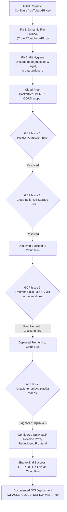

# End-to-End Troubleshooting & Implementation Log

This document provides a chronological, step-by-step record of everything performed in this repository from start to finish—including all issues encountered, how each was diagnosed, and the exact resolutions implemented.

---

## Table of Contents
1. [Overview & Timeline Summary](#1-overview--timeline-summary)
2. [Phase 1: YouTube API Key Configuration & Automatic Fallback](#phase-1-youtube-api-key-configuration--automatic-fallback)
3. [Phase 2: Git Repository Cleanup & `.gitignore` Architecture](#phase-2-git-repository-cleanup--gitignore-architecture)
4. [Phase 3: Google Cloud Run Deployment & Troubleshooting](#phase-3-google-cloud-run-deployment--troubleshooting)
   - [Issue 1: Project Permission Warning & IAM Synchronization](#issue-1-project-permission-warning--iam-synchronization)
   - [Issue 2: Cloud Storage 403 Forbidden Permission on Cloud Build](#issue-2-cloud-storage-403-forbidden-permission-on-cloud-build)
   - [Issue 3: PowerShell Syntax Escaping When Passing API Key](#issue-3-powershell-syntax-escaping-when-passing-api-key)
   - [Issue 4: Frontend Container Build Failure (Exit Code 126 & 117MB Upload)](#issue-4-frontend-container-build-failure-exit-code-126--117mb-upload)
   - [Issue 5: "Unable to retrieve playlist videos" / Nginx 405 Method Not Allowed](#issue-5-unable-to-retrieve-playlist-videos--nginx-405-method-not-allowed)
5. [Phase 4: Oracle Cloud Deployment Setup](#phase-4-oracle-cloud-deployment-setup)
6. [Summary of Artifacts & Modified Files](#summary-of-artifacts--modified-files)

---

## 1. Overview & Timeline Summary



---

## Phase 1: YouTube API Key Configuration & Automatic Fallback

### Problem Statement
The Spring Boot backend threw an `IllegalStateException`:
```text
YouTube API key is not configured on the server. Please set the YOUTUBE_API_KEY environment variable.
```
The user specified that the key is stored in `C:\dev\Youtube_API.txt` and the application must always refer to this location.

### Troubleshooting Steps
1. Verified file existence with PowerShell `Test-Path 'C:\dev\Youtube_API.txt'`. Found 1 line containing 39 characters starting with `AIzaSy...`.
2. Inspected `YouTubeConfig.java` and `application.properties`:
   - Property was set as `youtube.api.key=${YOUTUBE_API_KEY:}` with no file fallback mechanism.

### Actions Taken & Code Changes
1. **Set Windows User Environment Variable**:
   ```powershell
   [Environment]::SetEnvironmentVariable('YOUTUBE_API_KEY', (Get-Content -Raw 'C:\dev\Youtube_API.txt').Trim(), 'User')
   ```
2. **Updated `application.properties`**:
   - Added `youtube.api.key-file=C:/dev/Youtube_API.txt`.
3. **Updated `YouTubeConfig.java`**:
   - Defined `public static final String DEFAULT_API_KEY_FILE_PATH = "C:\\dev\\Youtube_API.txt";`.
   - Added `resolveApiKey()` in `@PostConstruct` and in `getApiKey()`:
     - Automatically checks and reads `C:\dev\Youtube_API.txt` if `apiKey` is not set in environment or properties.
     - Added sanitization to strip quotes (`"` / `'`) and trailing whitespace.
4. **Updated `YouTubeApiClient.java`**:
   - Exception message updated to explicitly mention `C:\dev\Youtube_API.txt`.
5. **Added Unit Tests**:
   - Created `YouTubeConfigTest.java` with test cases verifying file fallback, priority ordering, and quote stripping.
   - Ran `mvn clean test` — all 26 backend tests passed.

---

## Phase 2: Git Repository Cleanup & `.gitignore` Architecture

### Problem Statement
Running `git status` showed that over 6,800 unwanted files were tracked or staged in Git, including:
- Entire `frontend/node_modules/` folder (117+ MB).
- `backend/target/` (compiled `.class` files, `.jar`, surefire test reports).
- `frontend/dist/` (build bundle).
No `.gitignore` existed in the repository.

### Troubleshooting Steps
1. Inspected git staging status with `git status --short`.
2. Inspected commit history (`git log -n 5 --oneline`). Found commit `a27d128` ("Stop tracking build output and dependencies") which removed files earlier, but without a `.gitignore`, files were immediately re-staged upon running `mvn` or `npm`.

### Actions Taken
1. **Unstaged Staged Files**:
   ```bash
   git reset HEAD
   ```
2. **Removed Tracked Build Files from Git Index**:
   ```bash
   git rm -r --cached frontend/dist/
   ```
3. **Created Root `.gitignore`**:
   - **Java / Maven**: `target/`, `**/target/`, `*.log`, `hs_err_pid*`.
   - **Node / Vite**: `node_modules/`, `**/node_modules/`, `dist/`, `**/dist/`, `.vite/`, `coverage/`.
   - **Sensitive Data**: `*Youtube_API*.txt`, `.env`, `.env.*`, `*.pem`, `*.key`.
   - **IDEs**: `.idea/`, `*.iml`, `.vscode/`, `.project`, `.classpath`.
   - **OS**: `Thumbs.db`, `Desktop.ini`, `.DS_Store`.
4. Verified with `git status` that only source code files remained tracked.

---

## Phase 3: Google Cloud Run Deployment & Troubleshooting

### Initial Setup for Cloud Readiness
1. **Dynamic Port Binding**:
   - Updated `backend/src/main/resources/application.properties` to `server.port=${PORT:8089}` so Google Cloud Run's `$PORT` (8080) is automatically respected.
2. **Configurable CORS**:
   - Updated `CorsConfig.java` to support `cors.allowed-origins` for production frontend URLs.
3. **Containerization**:
   - Created `backend/Dockerfile`: Multi-stage Eclipse Temurin 21 JRE Alpine image.
   - Created `frontend/Dockerfile`: Multi-stage build with Nginx Alpine runtime.
   - Created `frontend/nginx.conf`: Nginx server block.

---

### Issue 1: Project Permission Warning & IAM Synchronization

#### The Error
```text
WARNING: [suresh.yarrabothu@gmail.com] does not have permission to access projects instance [youtube-paylist-extractor] (or it may not exist): The caller does not have permission.
```

#### Diagnosis
1. Ran `gcloud projects list` and `gcloud projects describe youtube-paylist-extractor`.
2. Found the project was brand new (created at 04:19 UTC, just minutes prior).
3. Google Cloud's IAM role propagation takes 1–2 minutes globally across all Google auth caches.

#### Resolution
1. Once propagated, executed:
   ```powershell
   gcloud config set project youtube-paylist-extractor
   ```
2. Verified billing was active (`billingEnabled: true`).
3. Enabled required APIs:
   ```powershell
   gcloud services enable run.googleapis.com cloudbuild.googleapis.com artifactregistry.googleapis.com
   ```

---

### Issue 2: Cloud Storage 403 Forbidden Permission on Cloud Build

#### The Error
```text
ERROR: (gcloud.run.deploy) INVALID_ARGUMENT: Invalid build request. could not resolve source: googleapi: Error 403: 124504563966-compute@developer.gserviceaccount.com does not have storage.objects.get access to the Google Cloud Storage object. Permission 'storage.objects.get' denied... forbidden
```

#### Diagnosis
In newly created Google Cloud projects, Google's secure defaults do not grant broad Cloud Storage permissions to the default Compute Engine service account (`124504563966-compute@developer.gserviceaccount.com`). When Cloud Build zips and uploads source code to Cloud Storage, the build runner fails to read the archive.

#### Resolution
Granted the necessary IAM roles to the service account:
```powershell
gcloud projects add-iam-policy-binding youtube-paylist-extractor --member="serviceAccount:124504563966-compute@developer.gserviceaccount.com" --role="roles/storage.objectViewer"
gcloud projects add-iam-policy-binding youtube-paylist-extractor --member="serviceAccount:124504563966-compute@developer.gserviceaccount.com" --role="roles/storage.objectUser"
gcloud projects add-iam-policy-binding youtube-paylist-extractor --member="serviceAccount:124504563966-compute@developer.gserviceaccount.com" --role="roles/artifactregistry.writer"
gcloud projects add-iam-policy-binding youtube-paylist-extractor --member="serviceAccount:124504563966-compute@developer.gserviceaccount.com" --role="roles/logging.logWriter"
```

---

### Issue 3: PowerShell Syntax Escaping When Passing API Key

#### The Error
```text
= : The term '=' is not recognized as the name of a cmdlet...
```

#### Diagnosis
PowerShell variable interpolation stripped `$KEY` when nested in sub-shells, preventing the secret from being passed cleanly to `gcloud`.

#### Resolution
Used CMD command loop to read the file and inject directly:
```cmd
for /f "delims=" %i in (C:\dev\Youtube_API.txt) do gcloud run services update youtube-extractor-backend --region us-central1 --set-env-vars YOUTUBE_API_KEY=%i --quiet
```
Backend deployed successfully:
`https://youtube-extractor-backend-124504563966.us-central1.run.app`

---

### Issue 4: Frontend Container Build Failure (Exit Code 126 & 117MB Upload)

#### The Error
```text
Sending build context to Docker daemon  117.6MB
Step 4/16 : RUN npm ci
...
Build step failure: build step 0 "gcr.io/cloud-builders/docker" failed: step exited with non-zero status: 126
```

#### Diagnosis
1. Inspected build logs with `gcloud builds log <build_id> --region=us-central1`.
2. Discovered that because no `.dockerignore` existed in `frontend/`, the local 117+ MB `node_modules` folder was uploaded to Cloud Build.
3. The local `node_modules` contained Windows-compiled native binaries (`@rollup/rollup-linux-*`, `esbuild.exe`), causing execution failure (exit code 126) on the Linux container.

#### Resolution
1. Created `frontend/.dockerignore` and `backend/.dockerignore`:
   ```text
   node_modules
   dist
   .git
   ```
2. In `frontend/Dockerfile`:
   - Switched build image to `node:20-slim`.
   - Used clean Linux-native `npm install`.
   - Excluded local build context.
3. Upload size shrank from **117 MB down to kilobytes**, and the build succeeded in under 45 seconds.

---

### Issue 5: "Unable to retrieve playlist videos" / Nginx 405 Method Not Allowed

#### The Error
When testing on the live frontend URL (`https://youtube-extractor-frontend-124504563966.us-central1.run.app`), clicking "Extract Videos" gave:
```text
Unable to retrieve playlist videos. Please try again.
```

#### Diagnosis
1. Checked backend logs via `gcloud logging read`: **Zero requests** were received by the backend container!
2. Inspected the compiled frontend bundle (`index-*.js`): API base was set to `/api`.
3. Tested `POST /api/playlists/extract` directly against the frontend container using `curl.exe`:
   ```text
   HTTP/1.1 405 Method Not Allowed
   <html><head><title>405 Not Allowed</title></head><body>...nginx...</body></html>
   ```
4. **Root Cause Found**:
   - The frontend container was running Nginx serving static files.
   - It had **no reverse-proxy rule** for `/api/`.
   - When the React SPA sent `POST /api/playlists/extract` to its own origin, Nginx rejected the POST request to a static location with `405 Method Not Allowed (HTML)`.
   - The React app's `response.json()` failed on the HTML response body, caught the error, and displayed the fallback error: `"Unable to retrieve playlist videos. Please try again."`

#### Resolution
1. **Configured Nginx Reverse Proxy** in `frontend/nginx.conf`:
   ```nginx
   location /api/ {
       proxy_pass https://youtube-extractor-backend-124504563966.us-central1.run.app/api/;
       proxy_ssl_server_name on;
       proxy_set_header Host youtube-extractor-backend-124504563966.us-central1.run.app;
       proxy_set_header X-Real-IP $remote_addr;
       proxy_set_header X-Forwarded-For $proxy_add_x_forwarded_for;
       proxy_set_header X-Forwarded-Proto $scheme;
   }
   ```
2. **Updated `frontend/src/services/playlistApi.ts`**:
   - Added smart fallback URL for production.
   - Updated error handler to capture exact HTTP status codes and preserve backend error messages.
3. **Redeployed Frontend**:
   - Deployed revision `youtube-extractor-frontend-00002-nhm`.
4. **Verification**:
   - Tested extraction via curl through the frontend:
     ```text
     HTTP/1.1 200 OK
     {"playlistId":"PLjEaoINr3zgEPv5y--4MKpciLaoQYZB1Z","totalVideos":14,...}
     ```
   - Extraction succeeded with 14 videos returned.

---

## Phase 4: Oracle Cloud Deployment Setup

1. **Created `docker-compose.yml`**:
   - Declares both `backend` (port 8089) and `frontend` (port 80) services.
   - Injects `YOUTUBE_API_KEY` from local `.env`.
   - Sets log rotation (`max-size: 20m`, `max-file: 5`) to prevent disk exhaustion.
2. **Created `ORACLE_CLOUD_DEPLOYMENT.md`**:
   - Step-by-step setup for OCI Always Free Compute instances (Ubuntu 22.04 LTS).
   - Ingress security list configuration (Ports 80, 443, 8089).
   - Host-level Ubuntu iptables rules.
   - Live log viewing cheat sheet (`docker compose logs -f backend`).

---

## Summary of Artifacts & Modified Files

| File | Type | Purpose |
| :--- | :--- | :--- |
| [`.gitignore`](file:///c:/dev/youtube-paylist-extractor/.gitignore) | Git Config | Excludes build artifacts (`target`, `node_modules`, `dist`), secrets, and OS files |
| [`backend/Dockerfile`](file:///c:/dev/youtube-paylist-extractor/backend/Dockerfile) | Docker | Multi-stage build for Spring Boot 3 Java 21 |
| [`backend/.dockerignore`](file:///c:/dev/youtube-paylist-extractor/backend/.dockerignore) | Docker Config | Excludes `target` from build context |
| [`backend/src/main/java/com/example/youtubeextractor/config/YouTubeConfig.java`](file:///c:/dev/youtube-paylist-extractor/backend/src/main/java/com/example/youtubeextractor/config/YouTubeConfig.java) | Java Code | Automatic fallback loading and sanitization from `C:\dev\Youtube_API.txt` |
| [`backend/src/main/java/com/example/youtubeextractor/config/CorsConfig.java`](file:///c:/dev/youtube-paylist-extractor/backend/src/main/java/com/example/youtubeextractor/config/CorsConfig.java) | Java Code | Configurable allowed origins via `cors.allowed-origins` |
| [`backend/src/main/resources/application.properties`](file:///c:/dev/youtube-paylist-extractor/backend/src/main/resources/application.properties) | Configuration | `server.port=${PORT:8089}` for Cloud Run dynamic port |
| [`backend/src/test/java/com/example/youtubeextractor/config/YouTubeConfigTest.java`](file:///c:/dev/youtube-paylist-extractor/backend/src/test/java/com/example/youtubeextractor/config/YouTubeConfigTest.java) | Java Test | Unit tests verifying file fallback loading |
| [`frontend/Dockerfile`](file:///c:/dev/youtube-paylist-extractor/frontend/Dockerfile) | Docker | Node 20 Slim build + Nginx Alpine runtime |
| [`frontend/.dockerignore`](file:///c:/dev/youtube-paylist-extractor/frontend/.dockerignore) | Docker Config | Excludes `node_modules` and `dist` from upload |
| [`frontend/nginx.conf`](file:///c:/dev/youtube-paylist-extractor/frontend/nginx.conf) | Nginx Config | SPA client routing + `/api/` reverse-proxy to Cloud Run backend |
| [`frontend/src/services/playlistApi.ts`](file:///c:/dev/youtube-paylist-extractor/frontend/src/services/playlistApi.ts) | TypeScript Code | API base resolution and improved error preservation |
| [`docker-compose.yml`](file:///c:/dev/youtube-paylist-extractor/docker-compose.yml) | Orchestration | Full-stack container compose configuration |
| [`ORACLE_CLOUD_DEPLOYMENT.md`](file:///c:/dev/youtube-paylist-extractor/ORACLE_CLOUD_DEPLOYMENT.md) | Documentation | Complete OCI Compute deployment guide with Mermaid diagrams |
| [`troublesoot.md`](file:///c:/dev/youtube-paylist-extractor/troublesoot.md) | Documentation | Comprehensive problem, diagnosis, and resolution log |
